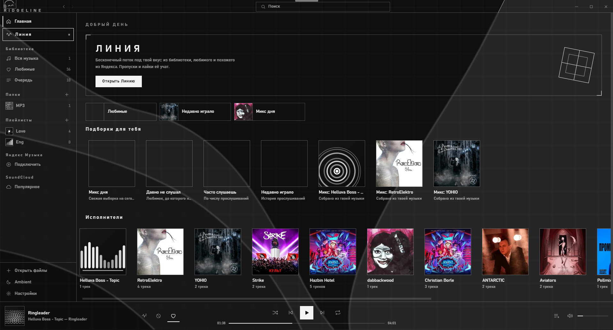
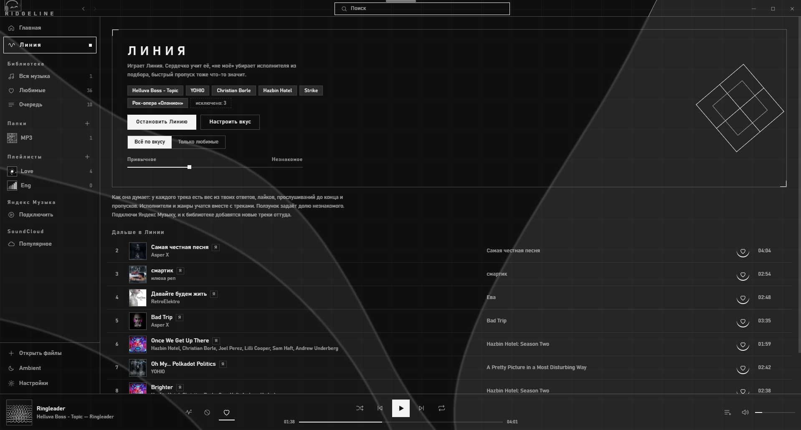
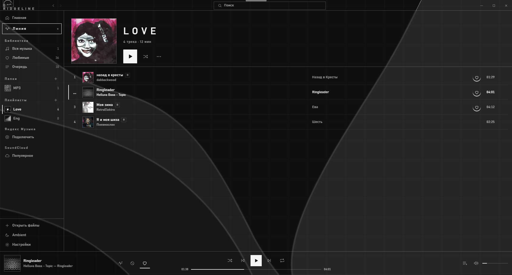
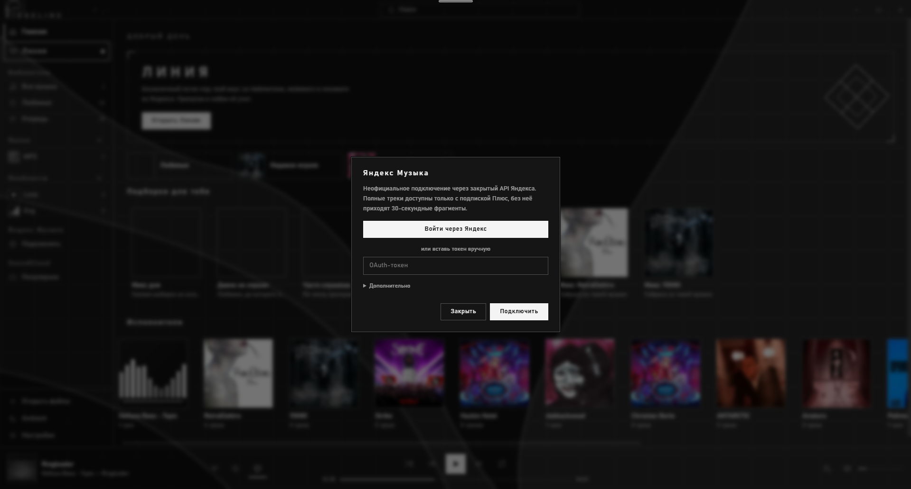
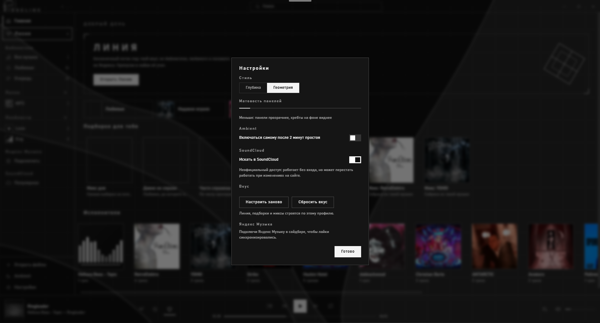

# Ridgeline

Нативный музыкальный плеер **v0.1-Beta**: локальная библиотека, Яндекс Музыка и SoundCloud в одном окне.

Tauri 2 + Rust: интерфейс — ванильные ES-модули (`src/renderer`), бэкенд — Rust (`src-tauri/src`).
Установленный exe весит ~12 МБ, установщик — ~3 МБ.

## Возможности

- **Локальная библиотека** — обход папок, теги через lofty, обложки, перемотка (протокол `media://` с Range)
- **Яндекс Музыка** — вход через oauth-окно, Лайки, моя волна, плейлисты, поиск; токен шифруется DPAPI
- **SoundCloud** — поиск, чарты, HLS-стримы через протокол `scproxy://`
- Очередь, статистика прослушивания, файловые ассоциации (mp3/flac/ogg/wav/m4a), дроп файлов в окно
- Один экземпляр приложения: повторный запуск поднимает существующее окно

## Установка

**Windows** — `Ridgeline_0.1.0_x64-setup.exe` (NSIS, без прав администратора):
ставится в `%LOCALAPPDATA%\Ridgeline`, прописывает ярлык в меню Пуск и ассоциации аудио.

**macOS** — собирается на GitHub: Actions → «macOS build» (`.github/workflows/mac.yml`),
результат — universal-бинарник (arm64 + x64): `.dmg` и `.zip` в артефактах запуска.
Первый запуск: правый клик по .app → **Открыть** (сборка с ad-hoc подписью).

## Сборка из исходников

```sh
npm install
npm start          # запуск в dev
npm run dist       # сборка + бандлинг (nsis) в src-tauri/target/release/bundle
```

На Windows для бандлинга нужен Resource Compiler из Windows SDK:

```sh
set RC=C:\Program Files (x86)\Windows Kits\10\bin\10.0.26100.0\x64\rc.exe
npm run dist
```

## Устройство

| Слой | Где |
|---|---|
| Интерфейс | `src/renderer/*` |
| Мост `window.api` | `src/api.js` — команды через `invoke`, события Яндекса/файлов |
| Файлы и теги | `fsx.rs` (обход папок, числовая сортировка), `meta.rs` (lofty) |
| Хранилище | `store.rs` (library/queue/playback/stats) |
| Яндекс Музыка | `ym.rs` (токен в DPAPI-шифровании) |
| SoundCloud | `sc.rs`, потоки через протокол `scproxy://` |
| Воспроизведение локально | протокол `media://` с поддержкой Range |
| Окно | `main.rs`: frameless (`data-tauri-drag-region`), single-instance, дроп файлов |

## Хранилище данных

Библиотека, статистика прослушивания и вход в Яндекс хранятся в одной папке:

- **Windows:** `%APPDATA%\Ridgeline`
- **macOS:** `~/Library/Application Support/Ridgeline`

Плеер читает и папку предыдущей сборки, если она есть на диске — библиотека переносится без ручных действий. Не запускай два экземпляра одновременно: файлы хранилища общие.

## Скриншоты

| | |
|---|---|
|  |  |
|  |  |
| |  |

## Дорожная карта

> Куда идёт Ridgeline по мере выхода из беты.

- 🌐 **Площадки** — Spotify и другие стриминги через их API: весь свой музыкальный мир в одном плеере
- 🐞 **Исправление багов** — дальний прицел на устойчивость: сети, краевые случаи, всё, что вы найдёте
- ✨ **Линия и маскоты** — доработка Линии и поведения маскотов: живее, характернее, отзывчивее
- 🧠 **Свой ИИ** — собственный движок рекомендаций: подборки и миксы, собранные локально и по-настоящему «про тебя»
- 🚀 **Первый релиз** — v1.0: стабильный, полный, без бета-звёздочек
